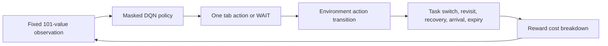
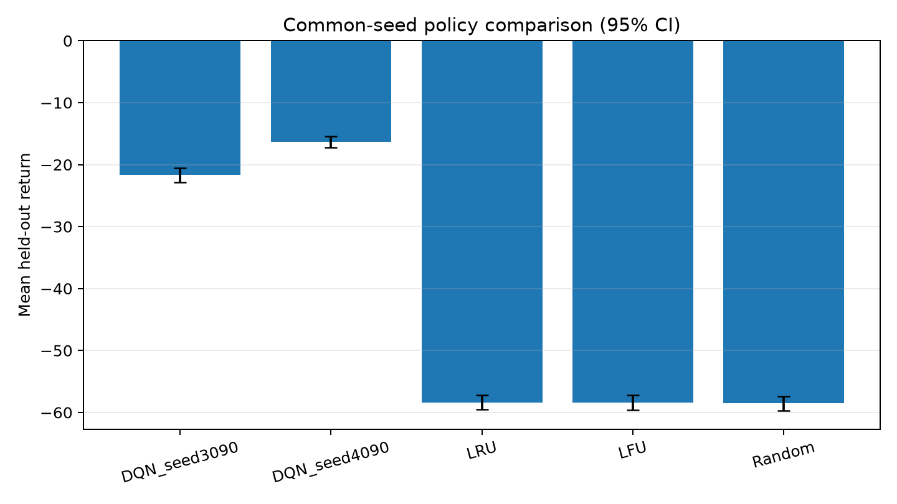
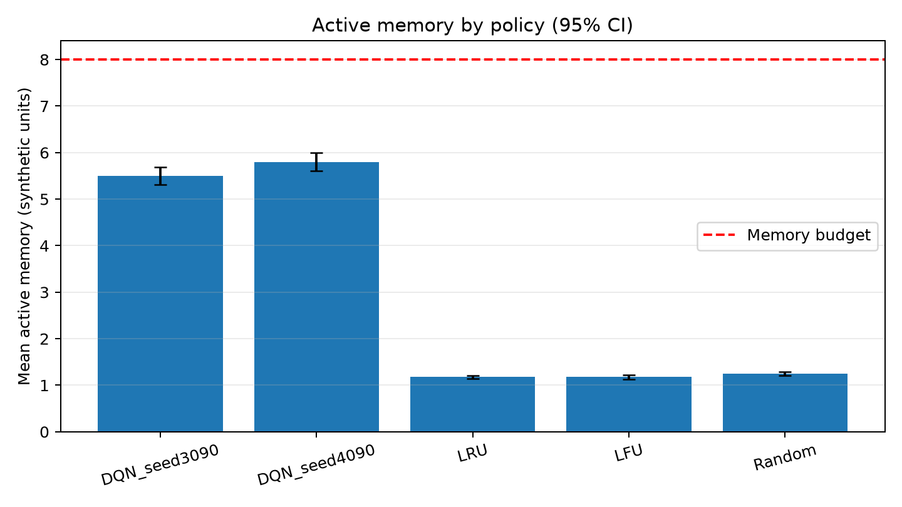

# TABasco

**Task-Aware Browser Tab Optimization using Reinforcement Learning** is an original Python/PyTorch project that models tab management as a finite-horizon MDP. V1 uses a simulated browser session; it is not a browser extension and does not interact with a real browser.

**Author:** Aarussh Shrivastava (B24CM1001), IIT Jodhpur<br>
**Course:** CSL3090 Artificial Intelligence, Assignment 2<br>
**Repository:** [github.com/Aarsussh/TABasco](https://github.com/Aarsussh/TABasco)

## Start here

Use Python 3.10 or newer. The direct Python dependencies are NumPy, Matplotlib, PyTorch, pytest, and ReportLab (for the PDF builder). The report is delivered as a two-column PDF with a companion LaTeX source. `report/build_report.py` regenerates the PDF from the saved evaluation tables and plots using ReportLab.

Windows PowerShell, from the repository root:

```powershell
python -m venv .venv
.\.venv\Scripts\Activate.ps1
python -m pip install --upgrade pip
python -m pip install -r requirements.txt
python -m pytest -q
python demo.py --seed 3090 --model-seed 4090
```

If PowerShell blocks activation, run `Set-ExecutionPolicy -Scope Process -ExecutionPolicy Bypass` in that terminal and activate again. On macOS/Linux, replace activation with `source .venv/bin/activate`. In the original workspace, the parent virtual environment can also run commands as `..\.venv\Scripts\python.exe ...` from this project directory.

The demo loads a saved constrained DQN and prints one deterministic 40-step episode by default: each policy action, memory after the step, automatic arrival/revisit events, and a cost/reward-accounting summary. Choose the other saved model with `--model-seed 3090`; use `--checkpoint PATH` to point at another compatible checkpoint. Pass `--steps 120` to match the training horizon.

## MDP



With `N=12` slots, the float32 observation is `8N+5 = 101` values. Each slot has: occupied, active, normalized memory size, normalized recency, normalized access frequency, current-task match, estimated revisit probability, and unsaved-work risk. The five global fields encode active memory/budget, task context, remaining horizon, elapsed fraction, and occupied-slot fraction. Tab memory sizes are sampled from 0.45 to 1.35 synthetic units. The session changes tasks, adds tabs, revisits active or suspended pages, may recover closed pages, and expires old tabs. Revisit probability is updated from session age, prior frequency, and task affinity.

The discrete action is `3 * slot + operation`: KEEP, SUSPEND, or CLOSE for one slot; the final action is WAIT. KEEP retains an active tab at no-op cost or restores a suspended tab. SUSPEND frees all active memory for that tab but retains its metadata. CLOSE removes it and leaves a finite recovery record. Empty-slot actions and redundant SUSPEND are invalid; WAIT is always valid. A single decision advances one time step. Episodes use a fixed 120-step horizon (truncated at the limit), so closing every tab cannot end the episode early.

The standard soft-budget environment counts active tabs against budget `B=8`; suspended tabs consume zero active-memory units. Its reward is the negative sum of costs:

`r = -[c_mem max(0, M-B) + restoration + 1.2 lost_work + 0.45 disruption + action + deferred_event]`.

Defaults include `c_mem=1`, restoration multiplier 0.8, valid action/WAIT cost 0.035, invalid action cost 0.12, and deferred-event cost 0.25. The environment reports the breakdown each step; components sum to the reward. No independent tab-count bonus is used.

### Constraint-aware environment

The selected final models use `--constraint-aware`. This variant enforces active memory as a transition invariant: initial overflow tabs start suspended; restoration actions that do not fit are masked; a suspended revisit that cannot fit stays suspended; closed recovery that cannot fit remains in history; and a new arrival that cannot fit is declined, not queued. Deferred automatic events cost 0.25. The invariant is checked after each transition, including automatic events. This guarantees the stated synthetic active-memory constraint only; it says nothing about real browser process memory.

## Agent and baselines

The learning policy is a compact 101-128-128-37 DQN. It uses ReLU, Adam, epsilon-greedy exploration, uniform experience replay, a target network, Huber TD loss, and gradient clipping. The observation-derived validity mask is applied in exploration, greedy selection, and target-value maximization. The stored next-state mask is used for replay. The agent is trained from environment rewards and transitions. LRU, LFU, and Random are independent evaluation baselines, not sources of DQN labels. Each suspends from the same active eligible-tab set; LRU selects oldest last visit, LFU selects lowest frequency then oldest, and Random samples uniformly. All WAIT when no tab is eligible.

## Quick baseline comparison (no training)

Load the two selected constraint-aware checkpoints and compare them with LRU, LFU, and Random on five reproducible scenarios. This short smoke run writes per-episode CSVs, a summary CSV, paired comparisons, and plots. It is separate from the 60-scenario report evaluation and is not used for model selection.

```powershell
python evaluate.py --checkpoint 3090=models/sensitivity/constrained_seed3090.pt --checkpoint 4090=models/sensitivity/constrained_seed4090.pt --episodes 5 --seed 93000 --constraint-aware --results-dir results/reproducibility_check
python plot_results.py --results-dir results/reproducibility_check --memory-budget 8 --output-dir results/reproducibility_check/plots
```

The selected checkpoints are loaded directly; these commands do not train or alter checkpoint weights. CSV and plot outputs in the chosen results directory are refreshed.

## Reproduce training and evaluation

The selected checkpoints were trained independently from fresh initialization on CPU for 250 episodes of at most 120 steps, seeds 3090 and 4090. DQN defaults: learning rate 0.001, gamma 0.97, batch 64, replay capacity 50,000, target update every 500 learner updates, epsilon 1.0 to 0.05 over 20,000 decisions. Run from the project root:

```powershell
python train.py --episodes 250 --max-steps 120 --seed 3090 --constraint-aware --checkpoint models/reproduced_seed3090.pt --results-dir results/reproduced/train_seed3090
python train.py --episodes 250 --max-steps 120 --seed 4090 --constraint-aware --checkpoint models/reproduced_seed4090.pt --results-dir results/reproduced/train_seed4090
python evaluate.py --checkpoint 3090=models/reproduced_seed3090.pt --checkpoint 4090=models/reproduced_seed4090.pt --episodes 60 --seed 91000 --constraint-aware --results-dir results/reproduced/evaluation
python plot_results.py --results-dir results/reproduced --memory-budget 8
```

Evaluation compares each policy on the same per-episode environment seeds, distinct from the training episode seeds. DQN uses greedy masked actions. The episode CSV contains raw per-policy metrics; the summary contains means, standard deviations, and normal-approximation 95% confidence intervals. `useful_revisit_success_rate` is task-matching revisit events divided by all recorded revisit events. Memory-violation steps count post-transition steps over budget; constrained runs should report zero. Plots are generated from CSV outputs. Re-running with the same software versions and seeds is intended to reproduce results; PyTorch/device/library version differences can affect exact floating-point outcomes.

## Results and provenance

Results are kept in separate directories so earlier runs remain auditable:

- `results/v1/` and `models/v1/`: initial run; superseded after validity, accounting, and termination issues were corrected.
- `results/corrected/`: corrected soft-budget experiment. Its DQN had a higher composite return than baselines but substantially more memory-violation steps; it is not the constraint-aware result.
- `results/sensitivity/`: memory-penalty sweep, validation selection, and the saved constraint-aware held-out evaluation.
- `results/final_optimization/`: later reward-weight validation experiment. Candidates did not show reliable two-seed improvement, so the selected checkpoints were retained.
- `results/reproducibility_check/`: five-episode smoke evaluation on separate seeds 93000-93004, with plots; verification only, not used for model selection or report metrics.

The selected constraint-aware evaluation used seeds 91000–91059. That block was examined in an earlier project analysis, so this is a **previously examined evaluation block**, not a newly untouched test. Results below are mean ± scenario SD over 60 episodes; higher return is better under the specified reward.

| Policy | Return | Useful revisit | Restoration cost | Lost-work cost | Violation steps |
|---|---:|---:|---:|---:|---:|
| DQN seed 3090 | -21.70 ± 4.51 | 0.824 | 5.69 | 6.73 | 0 |
| DQN seed 4090 | -16.31 ± 3.52 | 0.849 | 4.37 | 4.33 | 0 |
| LRU | -58.38 ± 4.67 | 0.886 | 16.32 | 1.69 | 0 |
| LFU | -58.43 ± 4.67 | 0.886 | 16.35 | 1.69 | 0 |
| Random | -58.55 ± 4.62 | 0.887 | 16.34 | 1.70 | 0 |

All policies had zero budget-violation steps under the constraint-aware transition rules. Useful-revisit success was 0.824 and 0.849 for the DQNs, versus 0.886, 0.886, and 0.887 for LRU, LFU, and Random. Thus, DQN had better composite return on this simulator block, while suspension baselines had higher useful revisit success. The environment enforces the memory invariant; these results do not show that DQN learned a hard memory guarantee.

The validation reward-weight study did not justify replacing the selected models. For the disruption-weight candidate, paired return differences versus matching control seeds were +2.43 (95% scenario CI +0.26 to +4.59) and -1.47 (-3.43 to +0.49); average effect +0.48 over only two training seeds, with lower useful revisit success. This descriptive two-seed average is not evidence of a reliable general improvement. Raw tables, configurations, and plots are retained beside each experiment.

Held-out comparison plots:





## Report

`report/report.tex` is the companion two-column LaTeX source; `report/report.pdf` is the generated report. The PDF builder reads the saved evaluation CSVs and embeds the corresponding plots, so numeric results are data-driven. Regenerate the PDF from the repository root with `python report/build_report.py`. ReportLab is listed in `requirements.txt`; no TeX installation is required for the PDF. The source can also be compiled independently with a LaTeX installation. The report has two content pages; references are on a separate page and excluded from the assignment page limit.

## Layout

```text
TABasco/
├── README.md
├── requirements.txt
├── demo.py
├── environment.py          # simulated tab-management MDP
├── agent.py                # masked PyTorch DQN and replay
├── baselines.py            # LRU, LFU, random evaluation policies
├── train.py                # reward-driven training and checkpoints
├── evaluate.py             # common-seed metrics and CSVs
├── plot_results.py         # CSV-based experiment plots
├── plot_sensitivity.py     # validation/test sweep plots
├── summarize_sensitivity.py
├── tests/
├── models/                 # selected and historical weights
├── results/                # CSVs, plots, configs, experiment notes
└── report/
    ├── report.tex
    ├── report.pdf
    └── build_report.py
```

## Project evolution

1. The initial simulator and LRU/LFU/Random baselines established the MDP and comparison policies.
2. The corrected version unified action validity and masking, reward accounting, and fixed-horizon termination after the first run showed invalid decisions and early-stop issues.
3. Audits traced soft-budget violations to agent operations and automatic arrivals/revisits; increasing the memory coefficient reduced but did not eliminate violations.
4. The constraint-aware transition variant made infeasible restoration/recovery explicit and declined over-budget arrivals, enforcing the simulated active-memory invariant.
5. Reward-weight validation showed no consistent two-seed gain, so the selected constrained checkpoints were retained.

## Limitations

The workload, revisit probabilities, task value, and memory units are synthetic. Only two independent training seeds support the selected DQN; the evaluation confidence intervals describe scenario variation conditional on those fixed trained policies, not training-seed uncertainty. The high-performing composite return depends on the chosen reward weights, and DQN useful-revisit success is lower than for the suspension baselines. Constraint-aware event deferral trades off continuity for capacity. Future work should add more training seeds, calibrated browser traces, user-valued recovery semantics, and a real-browser memory measurement study before any deployment claim.

No changes are pushed to GitHub by the local reproduce commands.
