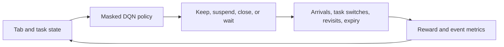
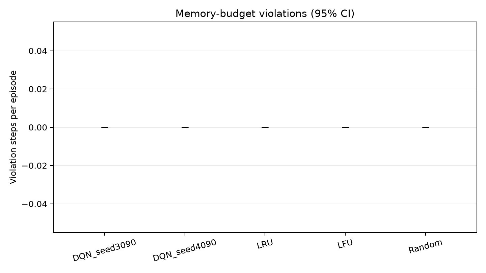

# TABasco — Task-Aware Browser Tab Optimization with Reinforcement Learning


Browser sessions grow quickly: some tabs are useful now, some will matter later, and active pages compete for limited memory. **TABasco** explores this trade-off with a reproducible simulated browser session and a reward-trained Deep Q-Network (DQN). It compares the learned policy with simple LRU, LFU, and random suspension policies.

> TABasco is a research and coursework simulator. It does not control a real browser.

## How it works

The environment models a browsing session as a finite-horizon Markov decision process. Tabs arrive, tasks change, pages are revisited, and suspended or closed pages may need restoration or recovery. At each step, the policy chooses one tab action or waits; the environment then advances the session and returns a reward and a cost breakdown.



### Highlights

- Fixed-size, seeded tab-management environment with active and suspended pages.
- Compact PyTorch DQN with replay, target network, epsilon-greedy exploration, and validity masks.
- Independent LRU, LFU, and random valid-action baselines.
- Optional constraint-aware transitions for enforcing the simulator’s active-memory budget.
- Common-seed evaluation, per-episode CSVs, confidence intervals, and result plots.
- Saved checkpoints and experiment metadata for inspection and repeatable runs.

## Results

The selected constraint-aware evaluation used the same 60 scenario seeds (91000–91059) for every policy. This evaluation block had already been examined during project development, so it is **not an untouched test set**. Entries show mean return ± scenario standard deviation; higher return is better under the configured reward.

| Policy | Return | Useful revisit success | Violation steps / episode |
|---|---:|---:|---:|
| DQN, training seed 3090 | **−21.70 ± 4.51** | 0.824 | 0 |
| DQN, training seed 4090 | **−16.31 ± 3.52** | 0.849 | 0 |
| LRU | −58.38 ± 4.67 | **0.886** | 0 |
| LFU | −58.43 ± 4.67 | **0.886** | 0 |
| Random | −58.55 ± 4.62 | **0.887** | 0 |

The DQN policies received better composite returns in this evaluation, while the suspension baselines had higher useful-revisit success. The zero-violation result comes from the constraint-aware environment’s transition rules; it is not a memory guarantee learned by DQN. These measurements describe this simulator and reward design, not real-world browser performance.

**Return comparison** — episodic reward across the common evaluation scenarios, with uncertainty shown in the plot.


**Active memory** — mean active memory use relative to the configured budget.


**Budget violations** — memory-violation comparison under the selected constraint-aware rules.



The raw evaluation episodes, aggregate statistics, paired return differences, and run configuration are in [`results/sensitivity/heldout_constraint/`](results/sensitivity/heldout_constraint/). Earlier soft-budget runs, penalty sensitivity experiments, and later reward-weight validation remain available under `results/` for context.

## Environment and learning setup

### Observation and actions

For `N = 12` slots, the observation is a fixed 101-value vector (`8N + 5`). Each slot contributes occupancy, active/suspended status, normalized memory size, recency, access frequency, current-task match, estimated revisit probability, and unsaved-work risk. Five global features represent memory relative to budget, task context, horizon progress, and occupancy.

The discrete action space has 37 actions: `3 × 12` tab-specific KEEP, SUSPEND, or CLOSE actions, plus WAIT. KEEP leaves an active tab open or restores a suspended tab. SUSPEND frees that tab’s active memory while retaining its metadata. CLOSE removes the tab while leaving a finite recovery record. Empty-slot operations and redundant suspension are invalid; WAIT is always valid. One action advances one environment step.

### Reward and memory constraint

The reward is the negative sum of recorded costs:

`r = −[c_mem max(0, M − B) + restoration + 1.2 lost_work + 0.45 disruption + action + deferred_event]`

Here `M` is active memory and `B` is the budget (default 8 synthetic units). Suspended tabs use zero active-memory units. The ordinary soft-budget environment can exceed the budget and records the excess. The selected checkpoints were trained and evaluated with `--constraint-aware`: initial overflow tabs start suspended, infeasible restores and recoveries are deferred, and arrivals that do not fit are declined. That environment enforces its active-memory invariant across automatic events as well as agent actions. It is a simulator rule, not a property of the learned policy or of a production browser.

## Setup

Python 3.10 or newer is recommended. Dependencies are NumPy, Matplotlib, PyTorch, and pytest.

```powershell
# Windows PowerShell, from the repository root
python -m venv .venv
.\.venv\Scripts\Activate.ps1
python -m pip install --upgrade pip
python -m pip install -r requirements.txt
```

On macOS or Linux, activate the environment with `source .venv/bin/activate` instead.

## Run it

Run a readable episode with a saved checkpoint:

```bash
python demo.py --seed 3090 --model-seed 4090
```

Run the test suite:

```bash
python -m pytest -q
```

Compare the two selected DQNs with all three baselines on five reproducible smoke-test scenarios, then plot the resulting CSVs:

```powershell
python evaluate.py --checkpoint 3090=models/sensitivity/constrained_seed3090.pt --checkpoint 4090=models/sensitivity/constrained_seed4090.pt --episodes 5 --seed 93000 --constraint-aware --results-dir results/reproducibility_check
python plot_results.py --results-dir results/reproducibility_check --memory-budget 8 --output-dir results/reproducibility_check/plots
```

For a full 60-scenario evaluation with the selected checkpoints, use `--episodes 60 --seed 91000` and a separate output directory. The seed block above is retained for reproducibility, but is previously examined rather than an untouched test set.

Train a fresh constrained DQN on CPU with a chosen seed:

```powershell
python train.py --episodes 250 --max-steps 120 --seed 3090 --constraint-aware --checkpoint models/new_seed3090.pt --results-dir results/new_run/train_seed3090
python plot_results.py --results-dir results/new_run
```

Training configuration and episode metrics are saved alongside the checkpoint. The second command generates the training-return curve from `results/new_run/train_seed3090/training.csv`; it prints a note when evaluation CSVs are absent. For evaluation plots, point `plot_results.py` at the evaluation results directory as shown above.

## Project structure

```text
TABasco/
├── agent.py                 # Masked PyTorch DQN and replay buffer
├── baselines.py             # LRU, LFU, and random policies
├── demo.py                  # Readable single-episode walkthrough
├── environment.py           # Synthetic browser-session MDP
├── evaluate.py              # Common-seed policy evaluation and CSVs
├── plot_results.py          # Evaluation plots from CSV data
├── plot_sensitivity.py      # Reward-sensitivity plots
├── summarize_sensitivity.py # Reward-sensitivity summaries
├── train.py                 # Reward-driven DQN training
├── tests/                   # Environment and action-interface tests
├── models/                  # Trained and historical checkpoints
└── results/                 # Experiment CSVs, metadata, and figures
```

## Limitations

The workload, memory units, revisit probabilities, and task values are synthetic. Only two training seeds support the selected DQN comparison, and the evaluation intervals reflect scenario variation for those fixed models rather than training-seed uncertainty. Reward rankings depend on the chosen cost coefficients. The constraint-aware environment may defer or decline events to preserve its memory invariant. TABasco is not a browser extension, does not measure real browser memory, and should not be interpreted as a production tab manager.
